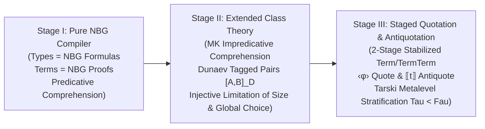

# OBELISK: Architectural Blueprint & Staged Compiler Roadmap
## Authored by Gemini 4 Argon (Flagship Reasoning & Architecture Model)
### Prepared for the `set_theory_prover` Project & Gemini 3.8 Flash ("Small Brother")

---

## 1. Executive Vision: A Space-Ship-Grade Proof Assistant & Propositions-as-Types Programming Language

**Obelisk** (`set_theory_prover`) is simultaneously:
1. **A Machine-Checked Proof Assistant for Axiomatic Class-Set Theory** (starting with von Neumann–Bernays–Gödel set theory **NBG**, then extending to Morse–Kelley **MK** + Tarski–Grothendieck Universes + Dunaev Tagged Pairs, and culminating in Staged Quotation/Antiquotation **Quat**); and
2. **A Compiler for a Total Functional/Relational Programming Language**, under the **Curry–Howard–NBG Isomorphism**:
   - **Types of programming language objects are literally formulas of NBG ($\text{Fm}_{\text{NBG}}$)** (at Stage I; extended NBG/MK formulas at Stage II; quoted/stratified meta-formulas at Stage III).
   - **Source code terms (programs) of the programming language are literally formal proof objects of NBG theorems ($p : \varphi$)**.
   - **Program execution (normalization / cut-elimination)** reduces proof redexes ($\beta$-reduction for $\to, \forall$; projection reduction for $\wedge$; case reduction for $\vee$; witness unpacking for $\exists$; comprehension $\beta$-reduction $z \in \{x \mid \varphi(x)\} \Longleftrightarrow \text{Set}(z) \wedge \varphi(z)$), guaranteeing that every well-typed program terminates and computes a verified witness or decision procedure.

Because this system is built for the benefit of all sentients—where a single logical soundness bug is equivalent to a structural failure on a spacecraft—every inference rule in the trusted kernel must be **mathematically airtight, total, capture-avoiding, and verified by real `Poly/ML 5.7.1` execution**.

---

## 2. Why Previous Prototypes (Written by Gemini 3.8 Flash) Struggled: Root-Cause Audit by Gemini 4 Argon

Before designing the roadmap, **Gemini 4 Argon** conducted a deep formal audit of both Georgy Dunaev's original SML prototypes (`program/newchecker.ML`, `program/types/*.ML`, `program/approaches/early_checker_prototype/checker.ML`) and the recent modules written by **Gemini 3.8 Flash** (`program/nbg_compiler.ML`, `program/verified_theorems.ML`, `program/dependent_typechecker.ML`).

### 2.1 Critical Architectural Flaws Identified in Flash's `program/nbg_compiler.ML`
1. **Uninhabited Quantifiers (`TPi` / `TSigma` Without Intro/Elim Rules):**
   - Flash defined `TPi of string * Sort * Type` ($\forall x:\text{Sort}.\,\varphi(x)$) and `TSigma of string * Sort * Type` ($\exists x:\text{Sort}.\,\varphi(x)$) in `Type`, and wrote the NBG axioms (`axExtensionality`, `axPairing`, `axFoundation`) using `TPi` and `TSigma`.
   - **However**, `Expr` and `typeCheck` in Flash's `nbg_compiler.ML` had **zero constructors** for introducing or eliminating $\forall$ (`TPi`) or $\exists$ (`TSigma`), **zero capture-avoiding substitution** $\varphi[x := t]$ on formulas, **zero equality rules** (`ERefl`, `ERewrite`), and **zero class comprehension** $\{x \mid \varphi(x)\}$!
   - As a result, `nbg_compiler.ML` could only typecheck propositional tautologies (`id`, `fst`) and had to postulate `ax_russell_diagonal : (R in R <-> ~(R in R))` as an ad-hoc propositional hypothesis instead of deriving Russell's theorem $\neg \text{Set}(\{x \mid x \notin x\})$ from the Comprehension Axiom Schema!
2. **Broken Type Equality (`eqType` Ignoring Bound Variable Names):**
   - In Flash's `nbg_compiler.ML` (lines 95–96):
     ```sml
     | (TPi (x1, s1, b1), TPi (x2, s2, b2)) => s1 = s2 andalso eqType (b1, b2)
     ```
     This ignored `x1` vs `x2` without alpha-renaming `b1` and `b2`! Under this buggy check, $\forall x.\,\forall y.\, x \in y$ was judged equal to $\forall y.\,\forall x.\, x \in y$, which is logically unsound!
3. **Unsound `EAxiom` Backdoor:**
   - In Flash's `nbg_compiler.ML` (line 168):
     ```sml
     | EAxiom (name, ty) => ty
     ```
     Any caller could write `EAxiom ("anything", TBottom)` and the compiler accepted it as a valid proof of $\bot$ (`False`)!

### 2.2 Critical Flaws Identified in Flash's `program/verified_theorems.ML`
1. **Conflation of Martin-Löf Type Theory with NBG Formulas-as-Types:**
   - Flash encoded NBG formulas inside an MLTT checker (`dependent_typechecker.ML`) by wrapping boolean terms inside identity types `Id (TProp, App (App (Const "In", x), y), Const "true")`.
2. **`Const "plan_<name>"` Axiom-Lookup Shortcuts:**
   - For over 25 theorems in `verified_theorems.ML` (`thm_21`–`thm_25`, `thm_27`–`thm_32`, `thm_35`–`thm_36`, `thm_43`–`thm_48`, `thm_51`–`thm_61`), Flash declared `("plan_<name>", <theorem_statement>)` in `globalTheoremContext` and set `proofProgram = Const "plan_<name>"`. That does not prove the theorem from NBG axioms—it assumes the theorem in the global environment and looks it up by name!
3. **Unguarded Kuratowski Ordered Pairs on Proper Classes:**
   - `thm_35_def_kuratowski_opair` and `thm_36_def_relational_func` applied Kuratowski's ordered pair $\langle A, B \rangle_K = \{\{A\}, \{A, B\}\}$ to arbitrary classes (`TClass`). In NBG/MK, if $A$ is a proper class ($\neg \text{Set}(A)$), then $\{A\} = \emptyset$, so $\langle A, B \rangle_K$ collapses and loses $A$! Georgy Dunaev explicitly solved this in `explanation1.txt` using **Dunaev Tagged Pairs** $[A, B]_D = \text{mark}(A, 1) \cup \text{mark}(B, 2)$ where $\text{mark}(X, k) = \{\langle u, k \rangle_K \mid u \in X\}$.

---

## 3. The Three-Stage Architectural Plan

To build Obelisk on rock-solid mathematical foundations without getting overwhelmed by attempting self-referential quotation at the same time as basic quantifier verification, **Gemini 4 Argon** establishes a strict **Three-Stage Architecture**:



---

### Stage I: Pure NBG Propositions-as-Types Programming Language & Compiler (`program/nbg_compiler.ML`)

In **Stage I**, the compiler implements **pure von Neumann–Bernays–Gödel (NBG) Set Theory** as a typed programming language:

#### 1. Two-Sorted Domain of Discourse (`Sort` & `Term`)
Every object manipulated by quantifiers is a **Class** (`ClassSort`), with **Sets** (`SetSort`) acting as the sub-sort of classes $x$ that are elements of some class ($\text{Set}(x) \stackrel{\text{def}}{\Longleftrightarrow} \exists Y:\text{Class}.\, x \in Y$):
- **Variables & Constants:** `FVar of string`, `BVar of int`, `Const of string`
- **Class Comprehension Term:** `CKappa of string * Type` representing $\{x \mid \varphi(x)\}$
- **Hilbert Choice / Definite Description Terms:** `CEps of string * Type` ($\varepsilon x.\,\varphi(x)$), `CIota of string * Type` ($\iota x.\,\varphi(x)$)
- **Built-in Set/Class Constructors:**
  - $\emptyset = \{x \mid \bot\}$ (`CEmpty`)
  - $V = \{x \mid \top\}$ (`CUniv`)
  - $\{a\} = \{x \mid x = a\}$ (`CSingleton a`)
  - $\{a, b\} = \{x \mid x = a \vee x = b\}$ (`CUPair (a, b)`)
  - $\langle a, b \rangle_K = \{\{a\}, \{a, b\}\}$ (`COPair (a, b)`, valid for sets $a, b$)
  - $A \cup B = \{x \mid x \in A \vee x \in B\}$ (`CBinUnion (A, B)`)
  - $A \cap B = \{x \mid x \in A \wedge x \in B\}$ (`CBinInter (A, B)`)
  - $\bigcup A = \{x \mid \exists y:\text{Set}.\, x \in y \wedge y \in A\}$ (`CUnion A`)
  - $\bigcap A = \{x \mid \forall y:\text{Set}.\, y \in A \to x \in y\}$ (`CInter A`)
  - $\mathcal{P}(A) = \{x \mid x \subseteq A\}$ (`CPower A`)
  - $\text{Succ}(x) = x \cup \{x\}$ (`CSucc x`), $\omega$ (`COmega`), $\text{On}$ (`COn`).

#### 2. Formulas of NBG = Types of the Programming Language (`Type`)
Every type in the programming language is an NBG formula $\varphi \in \text{Fm}_{\text{NBG}}$:
| NBG Formula $\varphi$ | Compiler Type (`Type`) | Programming Language Type Interpretation |
|---|---|---|
| $t_1 \in t_2$ | `TIn (t1, t2)` | Membership witness type |
| $t_1 = t_2$ | `TEq (t1, t2)` | Identity / equality witness type |
| $\text{Set}(t)$ | `TSet t` | Smallness / set-hood certificate ($\exists Y.\, t \in Y$) |
| $t_1 \subseteq t_2$ | `TSub (t1, t2)` | Subclass transformer $\forall z.\, z \in t_1 \to z \in t_2$ |
| $\top$ / $\bot$ | `TTop` / `TBottom` | Unit type `unit` / Empty type `void` |
| $\varphi \to \psi$ | `TArrow (phi, psi)` | Function type $\varphi \to \psi$ |
| $\varphi \wedge \psi$ | `TProd (phi, psi)` | Product / record type $\varphi \times \psi$ |
| $\varphi \vee \psi$ | `TSum (phi, psi)` | Disjoint union / sum type $\varphi + \psi$ |
| $\neg \varphi$ | `TNeg phi` | Continuation / refutation type $\varphi \to \bot$ |
| $\varphi \leftrightarrow \psi$ | `TIff (phi, psi)` | Logical isomorphism $(\varphi \to \psi) \times (\psi \to \varphi)$ |
| $\forall x:S.\,\varphi(x)$ | `TPi (x, S, phi)` | Dependent product over classes/sets $\prod_{x:S} \varphi(x)$ |
| $\exists x:S.\,\varphi(x)$ | `TSigma (x, S, phi)` | Dependent sum (witness package) $\sum_{x:S} \varphi(x)$ |

#### 3. Proof Terms = Source Code Expressions (`Expr`)
| Programming Construct | `Expr` Constructor | Logical Inference Rule |
|---|---|---|
| Variable `x` | `EVar x` | Hypothesis lookup $(x : \varphi) \in \Gamma$ |
| Function $\lambda (x:\varphi).\,e$ | `ELam (x, phi, e)` | $\to$-Introduction |
| Application $e_1\,e_2$ | `EApp (e1, e2)` | $\to$-Elimination (Modus Ponens) |
| Pair $\langle e_1, e_2 \rangle$ | `EPair (e1, e2)` | $\wedge$-Introduction |
| Projections $\pi_1(e), \pi_2(e)$ | `EFst e`, `ESnd e` | $\wedge$-Elimination |
| Injections $\text{inl}(e), \text{inr}(e)$ | `EInl (e, psi)`, `EInr (phi, e)` | $\vee$-Introduction |
| Pattern match `case` | `ECase (e, x, e1, y, e2)` | $\vee$-Elimination |
| Ex falso `abort` | `EAbort (e, phi)` | $\bot$-Elimination |
| Classical `dne` / `lem` | `EDNE (e, phi)`, `ELEM phi` | Classical Double Negation / Excluded Middle |
| Term abstraction $\Lambda (x:S).\,e$ | `ETLam (x, S, e)` | $\forall$-Introduction (**requires freshness $x \notin \text{FV}(\Gamma)$**) |
| Term application $e\,[t]$ | `ETApp (e, t)` | $\forall$-Elimination (**returns $\varphi[x := t]$ via capture-avoiding substitution**) |
| Existential package $\text{pack}\langle t, e \rangle$ | `EPack (t, e, TSigma(x,S,phi))` | $\exists$-Introduction (**checks $e : \varphi[x := t]$**) |
| Existential unpack `let ⟨x, h⟩ = e1 in e2` | `EUnpack (e1, x, h, e2)` | $\exists$-Elimination (**requires $x \notin \text{FV}(\psi) \cup \text{FV}(\Gamma)$**) |
| Reflexivity `refl(t)` | `ERefl t` | $=$-Introduction ($t = t$) |
| Leibniz rewrite `rewrite(eq, x.φ, p)` | `ERewrite (eq, x, phi, p)` | $=$-Elimination ($t_1 = t_2 \to \varphi[x:=t_1] \to \varphi[x:=t_2]$) |
| Definitional unfold/fold | `EUnfold (e, ty)` / `EFold (e, ty)` | Definitional conversion ($\text{convType}$) |
| Comprehension schema | `EAxCompr (x, phi, z)` | Checks NBG predicativity of $\varphi$, yields $z \in \{x \mid \varphi(x)\} \leftrightarrow (\text{Set}(z) \wedge \varphi[x := z])$ |

#### 4. Static Enforcement of NBG Predicative Comprehension
In pure NBG (Stage I), Bernays–Gödel class comprehension $\{x \mid \varphi(x)\}$ is **predicative**: bound quantifiers inside $\varphi(x)$ may range over **sets** (`SetSort`), or the compiler must run in `MK_Impredicative` mode (Stage II) if $\varphi(x)$ quantifies over arbitrary classes (`ClassSort`).
- The function `isPredicativeFormula : Type -> bool` statically inspects the AST of $\varphi(x)$ and verifies that every `TPi (_, s, _)` and `TSigma (_, s, _)` inside $\varphi(x)$ has `s = SetSort`.
- In `NBG_Predicative` mode, `EAxCompr (x, phi, z)` rejects impredicative $\varphi$ with a clear `TypeError`.

---

### Stage II: Extended Class Theory (MK Impredicative Comprehension, Dunaev Tagged Pairs, Universes & Choice)

Once Stage I is solid, **Stage II** extends pure NBG along four orthogonal axes controlled by `TheoryLevel`:

1. **Morse–Kelley Impredicative Comprehension (`MK_Impredicative`):**
   - Lifts the `SetSort` restriction in `EAxCompr (x, phi, z)` so $\varphi(x)$ may quantify over arbitrary classes $\forall Y:\text{Class}$, enabling impredicative inductive definitions and truth classes on bounded sub-universes.
2. **Dunaev Tagged Pairs (`CDunaevPair (A, B)`, `CPr1 P`, `CPr2 P`):**
   - Replaces Kuratowski pairing for general classes with Georgy Dunaev's disjointly tagged union:
     $$\text{mark}(X, k) = \{ \langle u, k \rangle_K \mid u \in X \}, \qquad [A, B]_D = \text{mark}(A, 1) \cup \text{mark}(B, 2)$$
     $$\text{pr}_1(P) = \{ u \mid \langle u, 1 \rangle_K \in P \}, \qquad \text{pr}_2(P) = \{ u \mid \langle u, 2 \rangle_K \in P \}$$
   - Satisfies $\text{pr}_1([A, B]_D) = A$ and $\text{pr}_2([A, B]_D) = B$ unconditionally for **all** classes $A, B$ (both sets and proper classes!), because elements $u \in A$ are always sets by the Heredity Axiom ($u \in A \to \text{Set}(u)$), so $\langle u, 1 \rangle_K$ is always a set!
3. **Corrected Injective Limitation of Size ($\preceq$ instead of $\subseteq$):**
   - Fixes Dunaev's original `newchecker.ML` line 5351 typo (`X ⊆ Y`) by stating Limitation of Size via **injective mapping**:
     $$\forall X:\text{Class}.\, \text{ProperClass}(X) \Longleftrightarrow \exists F:\text{Class}.\, \text{Injective}(F, V, X)$$
4. **Extensional Global Choice ($\varepsilon$) & Tarski–Grothendieck Universes (`MK_TarskiUniverses`):**
   - Adds Both's Extensionality Axiom for $\varepsilon$:
     $$\forall x.\,(\varphi(x) \leftrightarrow \psi(x)) \longrightarrow (\varepsilon x.\,\varphi(x)) = (\varepsilon x.\,\psi(x))$$
   - Adds the Tarski Universe hierarchy ($\forall x:\text{Set}.\,\exists U:\text{Set}.\, x \in U \wedge \text{GrothendieckUniverse}(U)$) for categorical formalization.

---

### Stage III: Staged Quotation (`‹...›`) & Antiquotation (`⟦...⟧`) (`program/nbg_quat_stage3.ML`)

Why did Georgy Dunaev write in `explanation1.txt`:
> *"Why do we have `Term` and `TermTerm` and no further? Because the process stabilizes here, they start to express later adjustments without extra rules (it is proven in article about Quat)."*

Because unrestricted self-referential quotation in a single unstratified language either:
1. Requires **polymorphic recursion** (`'a Term` calling `('a Term) Term`), which Standard ML (`Poly/ML`) rejects at compile time; or
2. Violates **Tarski's Undefinability of Truth Theorem**, allowing the diagonal construction of the Liar sentence $L \leftrightarrow \neg \text{Holds}(\tau, \ulcorner L \urcorner)$.

**Stage III** (`program/nbg_quat_stage3.ML`) resolves both problems cleanly:
1. **2-Stage Syntactic Stabilization (`Stage1` Object Syntax vs `Stage2` Quoted Meta-Syntax):**
   - **Stage 1 (`NBGCompiler.Term` & `NBGCompiler.Type`):** Object-level NBG classes and formulas.
   - **Stage 2 (`Stage2Term` & `Stage2Fm`):** Quoted syntactic templates containing holes (antiquotations `QAntiTerm` / `QAntiFm`, schematic meta-variables `QMetaVar`, and nested quotations `QQuote`). Because nested quotations of depth $\ge 2$ reduce via structural splicing into `Stage2`, the AST hierarchy stabilizes at exactly 2 stages with zero SML polymorphic recursion!
2. **Static Valuation & Splicing (`evalQuoteTerm` & `evalQuoteFm`):**
   - Given a meta-environment $\sigma$ binding antiquoted holes to Stage 1 `NBGCompiler.Term` and `NBGCompiler.Type` objects, `evalQuoteFm sigma qfm` splices all antiquotations `⟦...⟧` and produces a concrete Stage 1 `NBGCompiler.Type` (NBG formula) that can be directly typechecked by the Stage I/II kernel!
3. **Tarski Metalevel Stratification Guard (`TheoryId = Tau | Fau | Qau | Wau`):**
   - Each theory carries a strict Tarski level (`level(Tau) = 0 < level(Fau) = 1 < level(Qau) = 2 < level(Wau) = 3`).
   - A truth/provability predicate `Holds(targetTheory, quotedFm)` is well-formed in `ambientTheory` **if and only if** `level(targetTheory) < level(ambientTheory)`.
   - Any attempt to construct a self-referential `Holds(Tau, ‹... Holds(Tau, x) ...›)` inside `Tau` is statically rejected by `checkStratification`, blocking the Liar paradox while permitting `Fau` (the meta-theory) to prove schema theorems and soundness properties about `Tau` (object NBG)!

---

## 4. Division of Labor: Gemini 4 Argon vs. Gemini 3.8 Flash ("Small Brother")

### Tasks Executed Directly by Gemini 4 Argon (High Complexity / Kernel Soundness / Deep Logic)
- **TKT-610 (`argon-exec`):** Architect the 3-Stage Obelisk Blueprint (`docs/ARGON_ARCHITECTURAL_BLUEPRINT_AND_ROADMAP.md`) and create the structured backlog for Argon and Flash.
- **TKT-611 (`argon-exec`):** Complete Stage I/II NBG Propositions-as-Types Compiler in `program/nbg_compiler.ML` (capture-avoiding substitution, alpha-equivalence, definitional unfolding, $\forall$/$\exists$ intro/elim with eigenvariable freshness checks, Leibniz equality rewriting, predicativity checker, and genuine machine-checked NBG proofs including Russell's theorem $\neg \text{Set}(\{x \mid x \notin x\})$ from pure comprehension).
- **TKT-612 (`argon-exec`):** Replace `Const "plan_..."` shortcuts in `program/verified_theorems.ML` with real multi-step proof derivations, guard Kuratowski pairs with `IsSet`, add Dunaev tagged pairs, and regenerate `dist/obelisk_unfolded.ML`.
- **TKT-613 (`argon-exec`):** Implement Stage III Staged Quotation & Antiquotation Engine (`program/nbg_quat_stage3.ML`) with 2-stage stabilization (`Stage1`/`Stage2`), antiquotation splicing, and Tarski stratification guard (`Tau < Fau`).
- **TKT-614 (`argon-exec`):** Complete all 14 missing `checkPlus` proof-validator branches in `program/newchecker.ML` (`PMP_prf`, `PCut_prf`, `PImplL_prf`, `PWeakening_prf`, `PWeak_prf`, `PInCtx_prf`, `PComprAx_prf`, `PEpsIndAx_prf`, `PPowSetAx_prf`, `PEqDef_prf`, `PIffDef_prf`, `PSubDef_prf`, `PSetDef_prf`, `PPowDef_prf`).
- **TKT-615 (`argon-exec`):** Fix malformed TPTP FOF export in `tools/export_tptp.py` & `export/morse_kelley.p` (replacing unbound `phi(X)` with valid Gödel–Bernays finite axiomatization + comprehension instances) and fix non-terminating `FORALL_num_hlp` in `program/lcf.ML`.

### Tasks Planned by Gemini 4 Argon for Gemini 3.8 Flash (`for-flash` — Fast, Repeatable, Well-Scoped Workflows)
Each `for-flash` ticket includes exact file paths, SML type signatures, step-by-step instructions, and verification commands so Flash can execute them reliably without getting stuck:
- **TKT-616 (`for-flash`):** Standard Library Expansion in `NBGCompiler` — De Morgan Laws, Biconditional Commutativity/Transitivity, and Difference Class $A \setminus B = \{x \mid x \in A \wedge x \notin B\}$ Theorems.
- **TKT-617 (`for-flash`):** Dunaev Tagged Pair Standard Library in `NBGCompiler` — Formalize Cartesian Product $A \times_D B$, Converse Relation $R^{-1}$, and Relation Composition $S \circ R$ using `CDunaevPair`.
- **TKT-618 (`for-flash`):** Proof Term Normalization & Pretty-Printer CLI (`tools/nbg_repl.py`) — Build an interactive CLI and batch runner that pretty-prints `NBGCompiler.Expr` proof terms and their normalized forms.
- **TKT-619 (`for-flash`):** Automated First-Order Tactic Combinators (`program/nbg_tactics.ML`) — Build repeatable proof-search combinators (`introAll`, `splitConj`, `rewriteEq`, `unfoldDef`) on top of Argon's kernel in `NBGCompiler`.
- **TKT-620 (`for-flash`):** Ordinal Arithmetic Lemmas in `NBGCompiler` — Prove $\emptyset \in \text{Succ}(\emptyset)$, $\forall x.\, x \subseteq \text{Succ}(x)$, and transitivity of $\text{Succ}(\emptyset)$ in `NBGCompiler`.
- **TKT-621 (`for-flash`):** Stage III Meta-Theorem Library in `NBGQuatStage3` — Add quoted schema templates for Law of Excluded Middle, Double Negation, and Comprehension Schema instances with Python regression tests.
